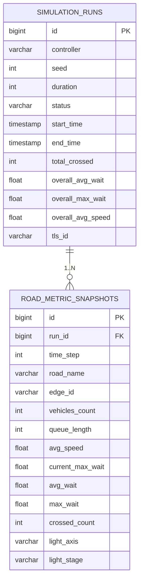

# 🚦 Superviser le Trafic dans une Intersection (Casablanca)

> **Projet :** Système intelligent de supervision, de régulation adaptative et d'analyse en temps réel du trafic urbain à une intersection critique de Casablanca (Boulevard d'Anfa × Rue Jean Jaurès).

---

## 📌 Sommaire

- [Vue d'ensemble](#-vue-densemble)
- [Architecture Globale](#-architecture-globale)
- [Modélisation du Réseau (Casablanca)](#-modélisation-du-réseau-casablanca)
- [Résultats & Comparaison (Feu Fixe vs Feu Intelligent)](#-résultats--comparaison-feu-fixe-vs-feu-intelligent)
- [Composants Implémentés](#-composants-implémentés)
- [Prérequis](#-prérequis)
- [Installation & Démarrage](#-installation--démarrage)
- [Documentation des API REST & WebSocket](#-documentation-des-api-rest--websocket)
- [Schéma de la Base de Données (PostgreSQL)](#-schéma-de-la-base-de-données-postgresql)
- [Feuille de Route (Roadmap)](#-feuille-de-route-roadmap)

---

## 🌟 Vue d'ensemble

Ce projet simule et supervise la circulation automobile au carrefour du **Boulevard d'Anfa** et de la **Rue Jean Jaurès** à Casablanca. 

Le système intègre :
1. **Un moteur de simulation microscopique (SUMO + TraCI)** modélisant les flux réels de véhicules et deux stratégies de contrôle des feux tricolores (Feu à temps fixe vs Feu intelligent adaptatif).
2. **Un microservice de contrôle FastAPI (Python)** pilotant TraCI dans un thread d'arrière-plan non-bloquant et diffusant les métriques seconde par seconde via **WebSocket**.
3. **Un backend d'entreprise Spring Boot (Java 21 / Spring Boot 3.3)** consommant les flux de métriques en continu, les agrégeant et les stockant dans une base **PostgreSQL**.
4. **Des API REST & WebSocket prêtes pour le frontend** permettant de visualiser en temps réel les files d'attente, les vitesses, les phases de feu et l'historique comparatif des performances.

---

## 🏗️ Architecture Globale

```
+-------------------------------------------------------------+
|               Moteur de Simulation Microscopique            |
|                   SUMO (sumo.exe / TraCI)                   |
|       Réseau Casablanca (Boulevard d'Anfa x Jean Jaurès)     |
+-------------------------------------------------------------+
                              ▲
                              │ TraCI (TCP Loopback)
                              ▼
+-------------------------------------------------------------+
|         Service de Contrôle Simulation — FastAPI (Python)   |
|         Port 8000 | Background Daemon Thread                |
|  - POST /start, POST /stop, GET /status                     |
|  - WebSocket /ws/metrics (Streaming 1 frame/sec)            |
+-------------------------------------------------------------+
                              ▲
                              │ HTTP REST + WebSocket Client
                              ▼
+-------------------------------------------------------------+
|             Backend Métier — Spring Boot 3.3 (Java 21)       |
|             Port 8080 | WebSocket Relay (/ws/live)          |
|  - FastApiClientService & Ingestion temps réel              |
|  - Contrôleurs REST : /api/simulation/* & /api/runs/*        |
+-------------------------------------------------------------+
                              ▲
                              │ Spring Data JPA / Hibernate
                              ▼
+-------------------------------------------------------------+
|                 Base de Données Relationnelle               |
|                    PostgreSQL 18 (Port 5432)                |
|  - simulation_runs (sessions & statistiques globales)       |
|  - road_metric_snapshots (historique seconde par seconde)   |
+-------------------------------------------------------------+
                              ▲
                              │ HTTP REST + WebSocket
                              ▼
+-------------------------------------------------------------+
|           Tableau de Bord — React Dashboard (Next Step)     |
|  - Monitoring en direct des feux et des files               |
|  - Graphiques de performance (Recharts / Chart.js)          |
|  - Comparateur interactif Feu Fixe vs Feu Intelligent       |
+-------------------------------------------------------------+
```

---

## 🗺️ Modélisation du Réseau (Casablanca)

Le réseau a été extrait depuis **OpenStreetMap** (Casablanca) et compilé avec `netconvert` :
- **Intersection TLS :** `cluster_12698757853_12698757855_2138359128`

| Axe | Approche | Identifiant Edge | Voies | Vitesse Max | Rôle |
|---|---|---|---|---|---|
| **Axe A** | Boulevard d'Anfa (depuis SW) | `-1371159828#2` | 2 voies | 60 km/h | Artère principale |
| **Axe A** | Boulevard d'Anfa (depuis NE) | `1371159828#0` | 2 voies | 60 km/h | Artère principale |
| **Axe B** | Rue Jean Jaurès (depuis SE) | `8013563#4` | 1 voie | 50 km/h | Voie secondaire |

---

## 📈 Résultats & Comparaison (Feu Fixe vs Feu Intelligent)

Benchmark réalisé sur **3 graines aléatoires (seeds)** de 1800 secondes (30 minutes réelles simulées) chacune :

| Indicateur clé | Régulation Fixe (Cycle 35s/35s) | Régulation Intelligente (Smart) | Amélioration |
|---|---|---|---|
| **Temps d'attente moyen** | **7.8 s** | **3.2 s** | **−59 %** 🚀 |
| **Temps d'attente maximum** | **43.0 s** | **26.0 s** | **−40 %** |
| **Temps perdu moyen (Time Loss)** | **12.6 s** | **7.5 s** | **−40 %** |
| **Émissions CO₂ par trajet** | **54.7 g** | **46.1 g** | **−16 %** 🌱 |
| **Capacité / Débit total** | 998 véhicules | 997 véhicules | Débit préservé à 100% |
| Attente Blvd d'Anfa (NE) | 10.4 s | 3.1 s | **−70 %** |
| Attente Rue Jean Jaurès | 9.5 s | 5.7 s | **−40 %** |

> **Conclusion clé pour la soutenance :** Le contrôleur intelligent réduit le temps d'attente global de près de **60%** et les émissions polluantes de **16%** sans dégrader la circulation sur la rue secondaire.

---

## 💻 Composants Implémentés

### 1. Module Simulation (`simulation/`)
- `runner.py` : Lance SUMO, instancie le contrôleur choisi, et produit un dictionnaire de métriques à chaque seconde simulée. Résolution multiplateforme de `SUMO_HOME` compatible Windows et Linux.
- `controllers.py` :
  - `FixedTimeController` : cycle classique invariable.
  - `SmartController` : algorithme adaptatif observant la demande réelle (nombre de véhicules à l'approche de la ligne d'arrêt dans un rayon de 100m) avec garde-fous de sécurité (vert minimum, vert maximum anti-famine, orange et rouge intégral).
- `metrics.py` : Agrégation des files d'attente, vitesses moyennes, véhicules arrêtés et temps d'attente par axe.
- `compare.py` : Comparaison multi-seeds automatique générant `results_casa.csv`.
- `generate_routes.py` : Génération des flux de trafic (distribution de Poisson).

### 2. Service API FastAPI (`api/`)
- `main.py` : Serveur FastAPI asynchrone gérant le cycle de vie de la simulation.
  - Exécute TraCI dans un thread démon dédié (`threading.Thread`) pour ne jamais bloquer la boucle d'événements HTTP.
  - Diffuse les métriques en continu à chaque client WebSocket connecté.
  - Supporte `step_delay` paramétrable pour adapter la vitesse d'exécution.
- `test_client.py` : Script de test unitaire en ligne de commande pour le WebSocket.

### 3. Backend Spring Boot (`backend/`)
- **Framework :** Spring Boot 3.3.5 / Java 21 / Maven 3.9.
- **Entités JPA & Persistance :**
  - `SimulationRun` : métadonnées et statistiques agrégées.
  - `RoadMetricSnapshot` : instantanés par route et par seconde.
- **Service d'ingestion WebSocket :** `FastApiMetricsIngestionService` se connecte automatiquement au WebSocket de FastAPI dès son démarrage et stocke chaque instantané en base PostgreSQL.
- **Contrôleurs REST & WebSocket :**
  - `SimulationController` (`/api/simulation`) : `/start`, `/stop`, `/status`.
  - `AnalyticsController` (`/api/runs`) : consultation de l'historique, échantillonnage temporel et comparateur.
  - `WebSocketConfig` : rediffusion sur `ws://localhost:8080/ws/live`.

---

## ⚙️ Prérequis

- **Système d'exploitation :** Windows 10/11 ou Linux.
- **SUMO :** Eclipse SUMO 1.18+ (avec `sumo.exe` et `sumo-gui.exe`).
- **Python :** Python 3.10 à 3.12 (avec packages `sumolib`, `traci`, `fastapi`, `uvicorn`, `websockets`).
- **Java :** JDK 21 ou JDK 23.
- **Maven :** Apache Maven 3.9+.
- **PostgreSQL :** PostgreSQL 15, 16 ou 18 (port 5432).

---

## 🚀 Installation & Démarrage

### Étape 1 : Base de Données PostgreSQL
Vérifiez que PostgreSQL écoute sur le port 5432 et créez la base :
```sql
CREATE DATABASE traffic_supervision;
```
*(Configuration par défaut : `username: postgres`, `password: 2003` - modifiable dans `backend/src/main/resources/application.properties`).*

### Étape 2 : Lancer le Service FastAPI (Port 8000)
```powershell
cd C:\Users\lamda\Downloads\traffic-supervision\api
python -m pip install -r requirements.txt
python main.py
```
*Le service démarre sur :* `http://localhost:8000`  
*Swagger Documentation :* `http://localhost:8000/docs`

### Étape 3 : Lancer le Backend Spring Boot (Port 8080)
Dans un autre terminal :
```powershell
cd C:\Users\lamda\Downloads\traffic-supervision\backend
mvn clean package -DskipTests
java -jar target/traffic-supervision-backend-1.0.0.jar
```
*Le backend démarre sur :* `http://localhost:8080`

---

## 📡 Documentation des API REST & WebSocket

### Endpoints Spring Boot (Port 8080)

#### 1. Démarrer une simulation
`POST /api/simulation/start`
```json
{
  "controller": "smart",
  "seed": 42,
  "duration": 1800,
  "stepDelay": 1.0
}
```
*Exemple de réponse :*
```json
{
  "id": 1,
  "controller": "smart",
  "seed": 42,
  "duration": 1800,
  "status": "RUNNING",
  "startTime": "2026-11-15T21:30:00.000",
  "tlsId": "cluster_12698757853_12698757855_2138359128"
}
```

#### 2. Arrêter la simulation
`POST /api/simulation/stop`

#### 3. Obtenir l'état courant
`GET /api/simulation/status`

#### 4. Historique des simulations
`GET /api/runs` : Liste toutes les sessions avec temps moyen, max et débit.  
`GET /api/runs/{id}` : Détails d'une session.  
`GET /api/runs/{id}/metrics?sampleRate=5` : Récupère les métriques temporelles échantillonnées (ex. 1 point toutes les 5 secondes pour alléger le rendu graphique).  
`GET /api/runs/compare?run1=1&run2=2` : Comparaison chiffrée entre deux sessions.

---

## 🗄️ Schéma de la Base de Données (PostgreSQL)



---

## 🎯 Feuille de Route (Roadmap)

- [x] **Étape 1 :** Simulation microscopique SUMO sur le réseau de Casablanca (Boulevard d'Anfa).
- [x] **Étape 2 :** Contrôleur intelligent adaptatif (SmartController) et benchmarking multi-seeds.
- [x] **Étape 3 :** Service de contrôle FastAPI non-bloquant avec streaming WebSocket.
- [x] **Étape 4 :** Base de données PostgreSQL avec persistance des sessions et des séries temporelles.
- [x] **Étape 5 :** Backend Spring Boot complet (REST + Ingestion temps réel + API Analytics).
- [ ] **Étape 6 (Prochaine étape) :** Dashboard interactif React (Vite / TypeScript / Tailwind CSS / Recharts / Lucide Icons).
- [ ] **Étape 7 (Optionnel) :** Intégration Apache Kafka si passage à un environnement distribué à forte charge.
